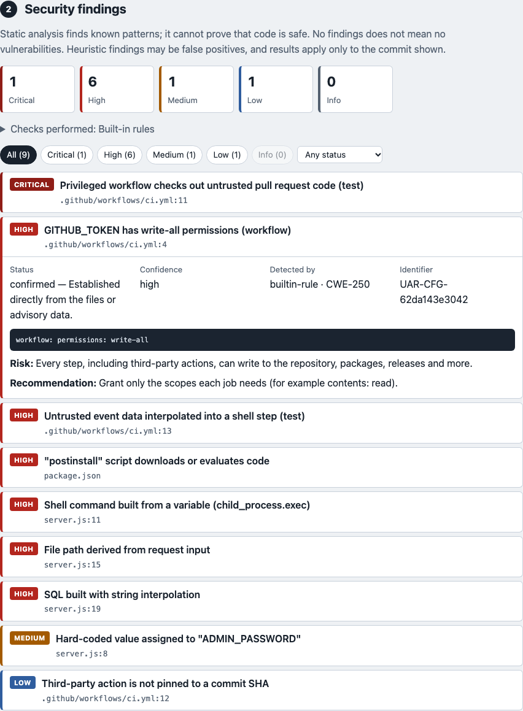
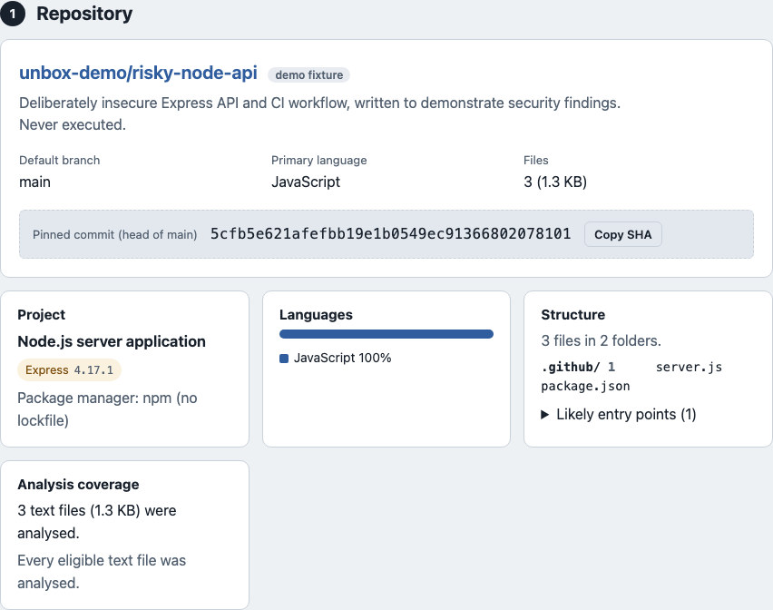
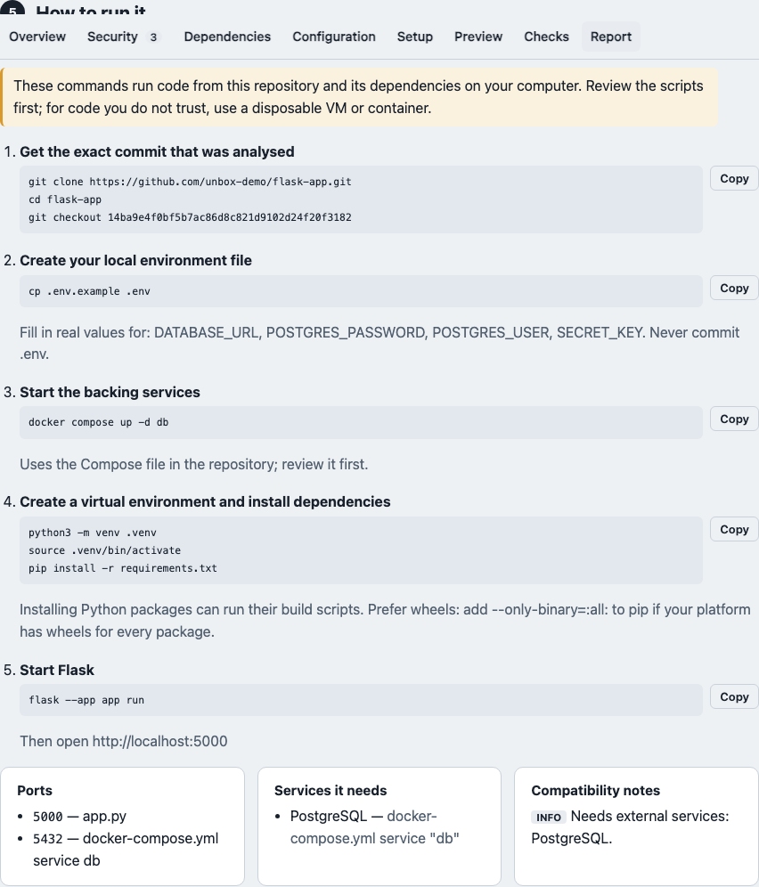
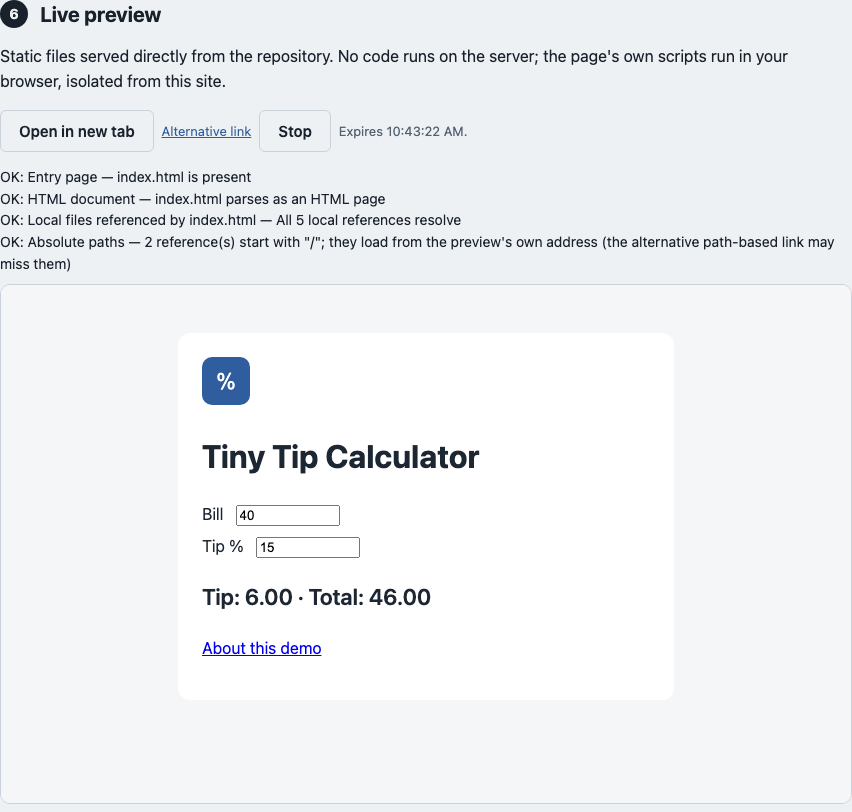

# UnboxAnyRepo

**From GitHub link to running project.**

[](https://github.com/SJ-Hariharan/UnboxAnyRepo/actions/workflows/ci.yml) [](LICENSE)

Paste a public GitHub repository URL. UnboxAnyRepo pins the exact commit, reads the code without running it, and tells you what the project is, how it is built, what it needs, what looks risky, and how to get it running. Static sites can be previewed live, and every investigation can be downloaded as a report.

> **Nothing here is a safety verdict.** Static analysis finds known patterns and misses others. "No findings" does not mean "no vulnerabilities", and a passing check does not mean the code is safe to run.



<sub>Screenshots use the bundled demo repositories in offline demo mode. Repository code was not executed; the run log image comes from a scripted test runner. Regenerate with `npm run screenshots`.</sub>

## What you get for a repository

| | |
|---|---|
| **Identity** | owner, default branch, exact commit SHA (everything below is pinned to it) |
| **Stack and structure** | languages by size, frameworks, runtimes, package managers, top-level layout, likely entry points |
| **Dependencies** | manifests and lockfiles (also in monorepo subfolders), exact package versions for JavaScript, Python, Go, Rust, Ruby, PHP, .NET and Dart, known vulnerabilities from [OSV.dev](https://osv.dev) |
| **Scripts and configuration** | build/start/test/install scripts (install lifecycle scripts highlighted), Dockerfiles, Compose services, CI workflows |
| **Environment** | variable names the code and examples use (never values), which are documented |
| **Security findings** | secrets, dangerous submodule URLs, command/SQL injection, unsafe deserialization, path traversal, risky install scripts, Docker/Compose hardening, GitHub Actions permissions and injection, TLS/CORS/JWT/debug settings, vulnerable dependencies, published repository advisories |
| **Setup guide** | commands for your machine from fixed templates (install with scripts disabled, env file, backing services, run, test), ports, required services, compatibility notes (EOL runtimes, native modules, submodules, LFS, lockfile conflicts) |
| **Live preview** | static sites and committed build output, served isolated from the app |
| **Report** | Markdown and JSON download with every finding, the setup guide and the limitations |

Each finding has a stable ID, severity, confidence, status (**confirmed**, **heuristic**, **informational**, **unverified**), file and line, redacted evidence, the risk, a recommendation, the detection method and references. Every tool says whether it ran, was not installed, failed or timed out; nothing is silently skipped.

Supported project types and exactly what works for each: [docs/SUPPORTED.md](docs/SUPPORTED.md).

| Overview | Setup guide | Live preview |
|---|---|---|
|  |  |  |

## How it works

```
GitHub URL ─▶ validate & pin commit ─▶ bounded archive, sanitized in memory ─▶ analyse (no code runs)
                                                                                 ├─ built-in rules
                                                                                 ├─ OSV.dev (exact versions)
                                                                                 ├─ Semgrep / Gitleaks (if installed)
                                                                                 └─ setup plan & preview eligibility
          ─▶ dashboard + report ─▶ static preview (isolated origin) ─▶ optional checks in a verified gVisor sandbox
```

- Only `github.com/<owner>/<repo>` URLs are accepted. The server builds every outbound URL itself and contacts only `api.github.com`, `codeload.github.com` and `api.osv.dev`, over HTTPS, to public IP addresses, re-validating every redirect.
- The archive is size-capped and parsed in memory. Traversal, escaping symlinks, hard links, devices and archive bombs are rejected.
- README instructions, Makefiles, Dockerfiles, CI workflows and install scripts are **never run** during analysis or preview.
- Running anything (tests, builds for previews) needs a gVisor sandbox that has passed real-container tests; see [Running checks](#running-checks-sandbox).

Details: [docs/ARCHITECTURE.md](docs/ARCHITECTURE.md) · [docs/THREAT_MODEL.md](docs/THREAT_MODEL.md) · [docs/API.md](docs/API.md).

## Quick start

Requirements: **Node.js 22.18 or newer** (TypeScript runs through Node's type stripping; no build step). Docker is not needed.

```sh
git clone https://github.com/SJ-Hariharan/UnboxAnyRepo.git
cd UnboxAnyRepo
npm ci

npm run demo    # offline: bundled demo repositories, no network
npm start       # live: public repositories on github.com
```

Open <http://127.0.0.1:8787>. Use `PORT=8788 npm start` if the port is taken. To keep settings in a file: `cp .env.example .env`, edit it, and start with `node --env-file=.env src/server.ts`.

Recommended for live mode: set `GITHUB_TOKEN` to a fine-grained token with **no permissions**. GitHub allows only 60 anonymous API requests per hour per IP address.

Optional, for deeper analysis (free, open source): install [Semgrep](https://semgrep.dev/docs/getting-started/) and [Gitleaks](https://github.com/gitleaks/gitleaks). They are used automatically when found (`UNBOX_SCANNERS=auto`). On macOS: `brew install semgrep gitleaks`. UnboxAnyRepo uses its own Semgrep rules (`rules/semgrep/`), not the Semgrep Registry, so no network access or registry licence is involved.

### Demo repositories

`npm run demo` serves the fixtures in `fixtures/demo-repos/`: `static-site` (live preview), `vite-app` (needs a build), `flask-app` (Python + PostgreSQL + Docker/Compose), `risky-node-api` (deliberately insecure code and CI, **never executed**), plus small Node, Python, Go and Rust projects and a Makefile-only repository.

## Live previews

| Kind | When | How |
|---|---|---|
| Static | `index.html` with no build step, or committed `dist/`/`build/`/`out/` | served from the snapshot; works without any sandbox |
| Build | Vite, Create React App, other front-ends, Next.js static export | `npm run build` in the verified sandbox, then the output is served |
| None | servers (Node, Python, Go…), containers | explained, with local setup steps instead |

Preview pages run in an **opaque origin** (`Content-Security-Policy: sandbox` without `allow-same-origin`): they cannot read UnboxAnyRepo's cookies, storage or API. Locally each preview also gets its own site, `http://<token>.preview.localhost:<port>/` (browsers resolve `*.localhost` to your machine; if yours does not, use the "Alternative link"). Preview links are random, owned by your browser session, expire after 30 minutes and can be stopped.

## Running checks (sandbox)

Execution is **disabled by default** and stays disabled unless all of these hold:

1. `UNBOX_RUNNER=docker` with `UNBOX_DOCKER_RUNTIME=runsc` on a Linux host with [gVisor](https://gvisor.dev/docs/user_guide/install/);
2. a live probe shows the `runsc` runtime really is gVisor;
3. `npm run sandbox -- --verify` ran the real-container tests (host isolation, no network, metadata and private-network denial, resource limits, timeouts, cancellation, cleanup after failure and crashes, missing images, concurrent-workspace isolation) and all required tests passed for the current Docker host and images.

```sh
npm run sandbox               # diagnostics: OS, Docker, runtimes, gVisor probe, image integrity, networks, record status
npm run sandbox -- --verify   # also runs the real-container tests and records the result if they all pass
```

Each line reports **PASS**, **FAIL**, **BLOCKED**, **NOT RUN** or **UNKNOWN**. Docker Desktop on macOS does not provide gVisor, so on a Mac the diagnostics report FAIL/BLOCKED and execution stays off; inspection, analysis, reports and static previews all work without it. Plain `runc` is never verified; it exists only as a labelled local development mode and is refused in production.

Checks: `npm test`/`build`/`lint`, `pytest`/`unittest`, `go test`/`vet`/`build`, `cargo test`/`build`. Every check step has **no network**; dependency installs reach only an egress proxy that allowlists package registries. Setup: [docs/DEPLOYMENT.md](docs/DEPLOYMENT.md).

## Deploying for free (inspection only)

`render.yaml` deploys an inspection-only instance on Render's free web service; the `Dockerfile` builds the same for other container hosts. Neither contains Docker or a sandbox, so code execution is impossible there. Constraints (sleeping when idle, ~512 MB memory, GitHub rate limits) and steps: [docs/DEPLOYMENT.md](docs/DEPLOYMENT.md#zero-cost-inspection-only-deployment). **A public deployment has not been tested yet.**

## Configuration

All settings are environment variables, validated at startup; [`.env.example`](.env.example) lists every one with its default. The most important:

| Variable | Default | Meaning |
|---|---|---|
| `GITHUB_TOKEN` | unset | Server-side only; raises GitHub API limits |
| `UNBOX_SCANNERS` | `auto` | `auto`, `off`, or `semgrep,gitleaks` |
| `UNBOX_OSV` | on (live), off (demo) | Known-vulnerability lookup |
| `UNBOX_PREVIEW_DOMAIN` | `preview.localhost` locally, off in production | Serve previews on `<token>.<domain>` |
| `UNBOX_RUNNER` | `disabled` | `docker` to allow execution (still needs verification) |
| `UNBOX_ARCHIVE_MAX_MB`, `UNBOX_ANALYSIS_MAX_TOTAL_MB` | 50, 40 | Download and analysis limits |
| `UNBOX_PRODUCT_NAME` | `UnboxAnyRepo` | Display name (brand text lives in `src/brand.ts`) |

## Testing

```sh
npm run typecheck                 # server, tests, scripts and the browser script
npm test                          # unit + API tests (no network, no Docker)
npx playwright install chromium   # once
npm run test:e2e                  # browser tests (scripted runner; nothing executed)
npm run test:docker               # real-container tests: skipped unless UNBOX_TEST_DOCKER=1 (use `npm run sandbox -- --verify`)
```

`npm test` includes a real Semgrep + Gitleaks run on harmless sample files when both are installed; otherwise that test is reported as skipped.

## Limitations

- Static analysis is pattern-based: it misses vulnerabilities that depend on data flow across files and reports false positives. Treat "heuristic" findings as leads.
- Vulnerabilities are matched only for exact versions (lockfiles or `==` pins) and only as known to OSV.dev at the time. Maven and Gradle projects, and Bun's binary `bun.lockb`, are not checked.
- Secrets are never tested, so a match may be a placeholder or revoked ("unverified").
- Very large repositories are analysed partially; the coverage note says what was skipped.
- Git submodule and Git LFS *contents* are not in GitHub archives. They are listed (submodule URLs, LFS pointer files and sizes) but not scanned. Symlinks are not followed.
- Server applications cannot be previewed; they get setup instructions.
- State is in memory and one process is supported.

## Documentation

| | |
|---|---|
| [docs/SUPPORTED.md](docs/SUPPORTED.md) | What works for each project type |
| [docs/API.md](docs/API.md) | HTTP API reference |
| [docs/ARCHITECTURE.md](docs/ARCHITECTURE.md) | Modules, pipeline, previews, runner |
| [docs/THREAT_MODEL.md](docs/THREAT_MODEL.md) | Assets, trust boundaries, mitigations, residual risks |
| [docs/DEPLOYMENT.md](docs/DEPLOYMENT.md) | Free inspection-only hosting and gVisor sandbox hosts |
| [docs/LAUNCH.md](docs/LAUNCH.md) | Launch checklist |
| [CHANGELOG.md](CHANGELOG.md) | Release history |
| [docs/RELEASE_REPORT.md](docs/RELEASE_REPORT.md) | What was tested for this release, and what was not |

## Contributing, security and licence

Read [CONTRIBUTING.md](CONTRIBUTING.md) and the [code of conduct](CODE_OF_CONDUCT.md). Report vulnerabilities privately as described in [SECURITY.md](SECURITY.md), not in public issues.

Released under the [MIT License](LICENSE). Runtime dependencies: `smol-toml` (BSD-3-Clause) and `yaml` (ISC). Optional external tools keep their own licences (Semgrep CE: LGPL-2.1; Gitleaks: MIT). Vulnerability data comes from OSV.dev and its sources.

Created and maintained by **Hariharan** ([@SJ-Hariharan](https://github.com/SJ-Hariharan)). Issues and pull requests: <https://github.com/SJ-Hariharan/UnboxAnyRepo/issues>. Contributors are listed in [AUTHORS.md](AUTHORS.md).
