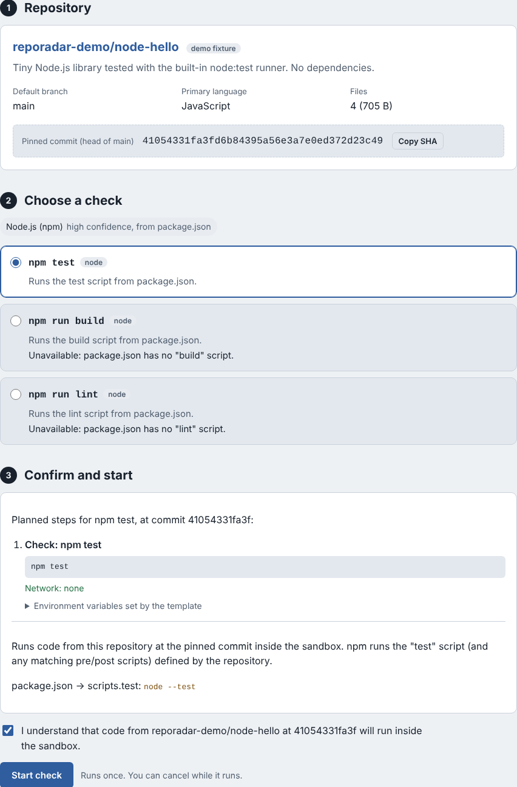
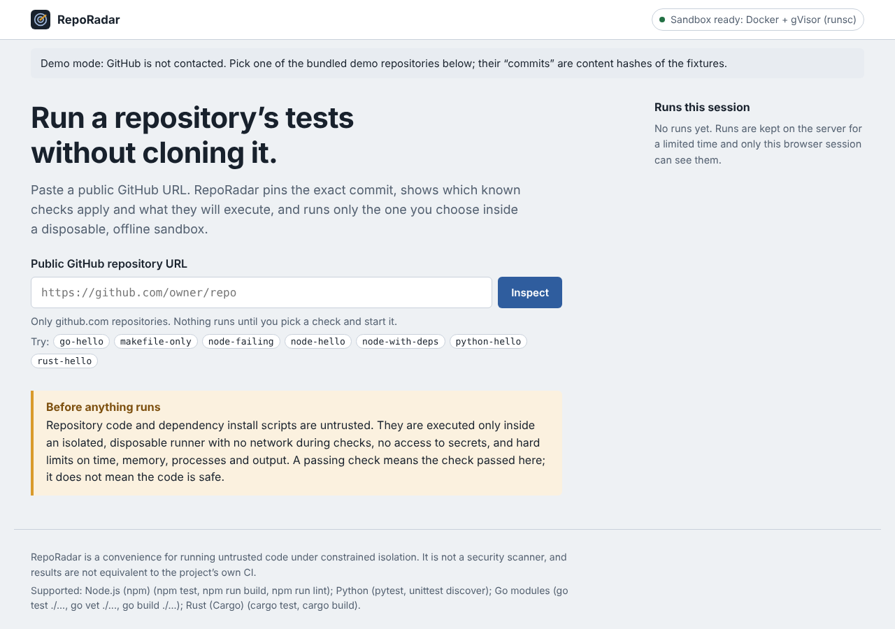
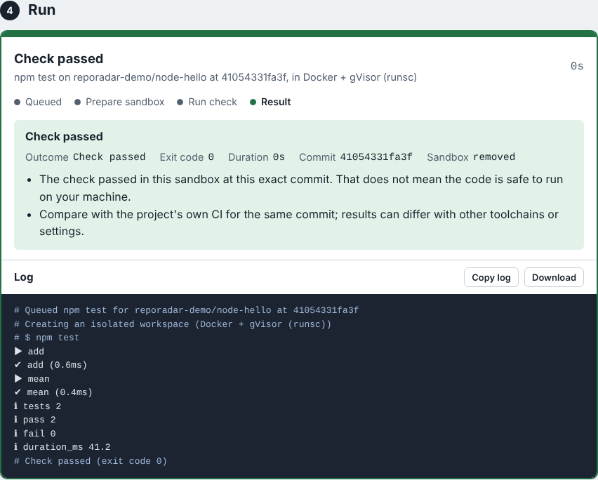

# RepoRadar

**Run a public GitHub repository's tests without cloning it.** Paste a URL; RepoRadar pins the exact commit, shows which known checks apply and exactly what they will execute, and runs only the one you choose inside a disposable, offline sandbox.

RepoRadar is for individual developers who want a quick, contained look at whether a repository builds and passes its tests before spending time on it, without running unfamiliar code on their own machine.

> **A passing check is not a safety verdict.** RepoRadar is a convenience for running untrusted code under constrained isolation. It is not a malware scanner, and its results are not equivalent to the project's own CI.



<sub>Screenshots are captured in demo mode against bundled fixtures with a scripted test runner, so no code was executed and the log text is sample output. Regenerate them with `npm run screenshots`.</sub>

## Features

- **Strict URL handling.** Only `github.com/<owner>/<repo>` is accepted. The server builds every outbound URL itself and contacts only `api.github.com` and `codeload.github.com`.
- **Pinned commit.** The default branch is resolved to a full SHA, shown to you, and used for everything that follows. A full SHA in the URL (`/tree/<sha>`) pins that commit instead.
- **Safe source handling.** The archive is size-capped and parsed in memory, never extracted on the server. Traversal, escaping symlinks, hard links, devices and archive bombs are rejected.
- **Cautious detection.** Supports Node.js (npm), Python, Go modules and Rust (Cargo) at the repository root. It says "unsupported" or explains why a check can't be offered rather than guessing.
- **Allowlisted checks only.** Each check comes from a fixed template. You see every command, its network access and its environment, plus any repository-defined script it will trigger, before you start.
- **Explicit start.** Nothing runs on page load or after a paste. A confirmation is required, and a second one when dependencies will be downloaded.
- **Disposable sandbox.** Docker with gVisor, no network for checks, non-root, read-only root filesystem, memory/CPU/PID/disk limits, hard timeouts, and verified cleanup.
- **Live, honest progress.** Server-sent events stream real phases and logs. Logs are plain text, sanitized, redacted and capped, with truncation made explicit. Cancellation is reported as confirmed only when the sandbox is actually gone.
- **Session history** for your browser session, and an offline **demo mode**.

### MVP scope

In scope: one public repository at a time, root-level detection for four ecosystems, ten predefined checks, one sandbox runner, in-memory state.

Out of scope, deliberately: private repositories, accounts, arbitrary commands, running CI workflows, Makefiles, Dockerfiles or README instructions, badges and publishing, AI-generated changes, dependency updates, and any form of security verdict.

## Supported ecosystems and checks

| Ecosystem | Detected from | Checks | Dependency install (needs registry proxy) |
|---|---|---|---|
| Node.js (npm) | `package.json` (+ `package-lock.json` / `npm-shrinkwrap.json`) | `npm test`, `npm run build`, `npm run lint` (only if the script exists) | `npm ci --ignore-scripts` (or `npm install --ignore-scripts --no-package-lock` without a lockfile) |
| Python | `pyproject.toml` (`[project]` deps, test/dev extras, dependency groups), root `requirements*.txt` | `python -m pytest -q`, or `python -m unittest discover` when there are no pytest signals | `pip install --only-binary=:all: --target …` (wheels only, pip config ignored) |
| Go | `go.mod` | `go test ./...`, `go vet ./...`, `go build ./...` | `go mod download` (skipped when `vendor/` exists or there are no requirements) |
| Rust | `Cargo.toml` (+ `Cargo.lock`) | `cargo test --offline`, `cargo build --offline` | `cargo fetch` |

Every check step runs with **no network**. Yarn, pnpm, Bun, Poetry-only, `setup.py`-only and dynamic-dependency projects are reported as unsupported for now, because their dependencies cannot be determined without running project code or tooling we don't yet template.

## Quick start

Requirements: Node.js **22.18 or newer** (TypeScript runs directly through Node's type stripping, so there is no build step).

```sh
git clone <this repository>
cd reporadar
npm install

npm run demo   # offline: bundled demo repositories, GitHub is not contacted
# or
npm start      # live: inspects public repositories on github.com
```

Open <http://127.0.0.1:8787>. By default **execution is disabled**: you can inspect repositories and review exactly what each check would run. To execute checks, set up a sandbox host as described below.



## Running checks: sandbox setup

Execution needs Docker with the **gVisor** runtime (`runsc`). Full instructions, including the recommended two-host layout, are in [docs/DEPLOYMENT.md](docs/DEPLOYMENT.md). In short:

```sh
# On the sandbox host
sudo runsc install && sudo systemctl restart docker      # after installing gVisor
node scripts/pull-images.ts                              # images are never pulled implicitly
docker compose -f deploy/compose.sandbox-host.yml up -d  # optional: dependency downloads

# RepoRadar
REPORADAR_RUNNER=docker REPORADAR_DOCKER_RUNTIME=runsc \
REPORADAR_FETCH_NETWORK=reporadar-fetch REPORADAR_FETCH_PROXY_URL=http://reporadar-egress:3128 \
npm start
```

**When the sandbox is unavailable**, because the runtime is missing, Docker is unreachable or images aren't pulled, RepoRadar keeps inspection working, disables execution, and shows the reason in the header and next to each check. It never falls back to running code on the host or in a weaker sandbox.

For local development on a throwaway VM you can opt into plain containers (`REPORADAR_DOCKER_RUNTIME=runc` plus `REPORADAR_ALLOW_UNSAFE_LOCAL_RUNNER=i-understand-runc-is-not-a-strong-sandbox`). The UI then shows a red "unsafe" banner, and this mode is refused when `NODE_ENV=production`.



## Configuration

All configuration is through environment variables, validated at startup. See [`.env.example`](.env.example) for the full list with defaults. The most important ones:

| Variable | Default | Meaning |
|---|---|---|
| `REPORADAR_RUNNER` | `disabled` | `docker` to enable execution. |
| `REPORADAR_DOCKER_RUNTIME` | `runsc` | gVisor. `runc` needs the unsafe-local acknowledgement. |
| `REPORADAR_DOCKER_HOST` | local daemon | Point at a dedicated sandbox host (`ssh://…`, `tcp://…`). |
| `REPORADAR_FETCH_NETWORK`, `REPORADAR_FETCH_PROXY_URL` | unset | Enable dependency downloads through the egress proxy. |
| `REPORADAR_IMAGE_NODE` / `_PYTHON` / `_GO` / `_RUST` | official slim images | Sandbox images; pin by digest. |
| `REPORADAR_RUN_MEMORY_MB`, `_CPUS`, `_PIDS`, `_WORKSPACE_MB` | 2048, 1, 256, 2048 | Per-container limits. |
| `REPORADAR_INSTALL_TIMEOUT_SEC`, `REPORADAR_CHECK_TIMEOUT_SEC` | 300, 600 | Hard per-step timeouts. |
| `GITHUB_TOKEN` | unset | Optional, server-side only, for higher GitHub API limits. |
| `REPORADAR_PRODUCT_NAME` | `RepoRadar` | Rebrand the UI. |

## Architecture and trust boundaries

```
browser ─▶ RepoRadar server ─▶ api.github.com / codeload.github.com   (fixed hosts, public IPs only)
              │  validate · pin SHA · sanitize archive in memory · detect · plan from templates
              ▼  docker CLI (argv only, no secrets)
           sandbox host: gVisor containers ── checks: no network
                                            └─ installs: internal network ─▶ egress proxy ─▶ package registries
```

The server is trusted and holds the only secrets. Everything from the browser, GitHub and the sandbox is treated as hostile input. The runner is an adapter behind a three-method interface, so a microVM or hosted-sandbox runner can replace Docker without touching the UI or API. Details: [docs/ARCHITECTURE.md](docs/ARCHITECTURE.md).

## Security model

- Repository code, its dependencies and their install scripts are untrusted and only ever execute inside the sandbox.
- No application secret, credential or host socket is passed into the sandbox. The Docker CLI runs with a minimal environment.
- Check steps have no network. Install steps can reach only an egress proxy that allowlists public package registries by exact hostname, on port 443, to public IP addresses.
- Timeouts and cancellation force-remove the container, which kills its whole process tree, and cleanup is verified.
- Run ids are 128-bit random, and every read, stream, download and cancel also checks the owning browser session.
- Logs are treated as hostile: escapes stripped, secrets redacted, size capped, never rendered as HTML.

**Residual risks** include gVisor or kernel vulnerabilities, untrusted packages downloaded from registries, in-memory per-IP rate limits that a distributed attacker can bypass, and the Docker API being root-equivalent on the sandbox host. Read the full [threat model](docs/THREAT_MODEL.md) before deploying for others.

**Reporting vulnerabilities:** see [SECURITY.md](SECURITY.md). Please do not open public issues for security problems.

## Testing and quality checks

```sh
npm run typecheck   # tsc over server, tests and the browser script (checkJs)
npm test            # unit + API tests (no network, no Docker)
npm run test:e2e    # browser tests with Playwright (run `npx playwright install chromium` once)
npm run check       # typecheck + unit + API
```

Real-container tests are opt-in because they need Docker and sandbox images:

```sh
REPORADAR_TEST_DOCKER=1 REPORADAR_DOCKER_RUNTIME=runsc npm run test:docker
```

They run the demo fixtures end to end and probe the sandbox from inside: uid, network, read-only root, environment, memory/PID/disk limits, timeout process-tree kill, cancellation, output caps and cleanup.

## Deployment

See [docs/DEPLOYMENT.md](docs/DEPLOYMENT.md) for the supported configuration, resource planning (about 4 GB RAM and 1 vCPU per concurrent run at default limits), reverse-proxy settings, rate limits and retention. Run a single server process; state is in memory. Inspections are kept for 15 minutes, finished runs and their capped logs for 1 hour, and nothing is written to disk.

## Known limitations

- Detection only looks at the repository root; monorepos are partially supported at best.
- npm only (no Yarn/pnpm/Bun); Python dependencies must be plain specifiers available as wheels; the Python project itself is not pip-installed (a `src/` layout is added to `PYTHONPATH`).
- Pinned toolchain files (`rust-toolchain`, a newer `go` directive) can make runs fail, because the sandbox only has its image's toolchain and toolchain downloads are disabled.
- Tests that need network, databases, browsers, GPUs or secrets will fail here by design.
- Symlinks inside a repository are not reproduced in the sandbox.
- A SHA pinned through the URL may belong to any fork in the repository's network (a GitHub behaviour).
- State is in memory: a restart forgets runs and sessions, and only one server process is supported.
- The egress proxy restricts destinations, not content.

## Roadmap

Driven by what makes the tool more useful and trustworthy, in rough order:

1. More ecosystem templates: pnpm and Yarn, Poetry and uv lockfiles, Maven/Gradle, Ruby.
2. A microVM runner (Firecracker) as a stronger alternative to gVisor.
3. Shareable, signed run reports that record commit, check template, image digests and limits.
4. Self-hosting improvements: a container image for the server, persistent storage option, metrics.
5. A CI job that runs the real-container tests under gVisor.

## Contributing

Contributions are welcome. Start with [CONTRIBUTING.md](CONTRIBUTING.md), and please follow the [code of conduct](CODE_OF_CONDUCT.md). Changes that touch the sandbox, archive handling, detection or templates need tests for the hostile cases, not just the happy path.

## License

**No license has been chosen yet.** Until the maintainers add a `LICENSE` file, all rights are reserved by default and this code is not open source. Choosing a license is a launch blocker; see [docs/LAUNCH.md](docs/LAUNCH.md).

## A note on popularity

Nobody can promise that a project will get stars or reach trending. RepoRadar aims to be useful and trustworthy; whether people adopt it depends on whether it solves their problem. See [docs/LAUNCH.md](docs/LAUNCH.md) for the launch plan.
